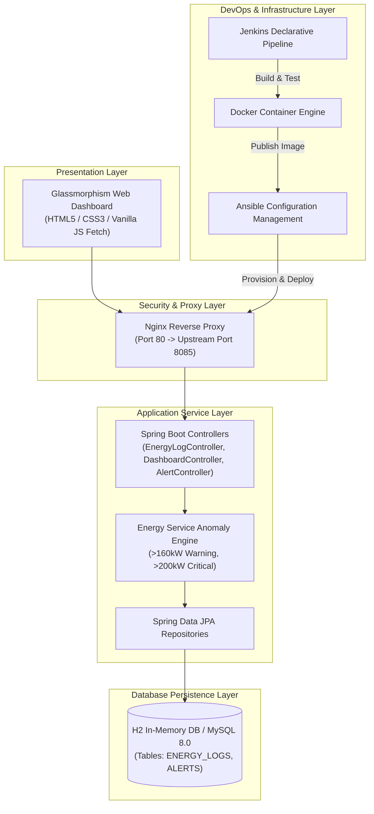

# Complete 15-Week Project Master Report & Roadmap Guide
## Factory Energy Consumption Dashboard

> **Enterprise Real-Time Telemetry Monitoring, Anomaly Exception Engine, Automated Selenium Testing, Jenkins-Docker CI/CD & Ansible Configuration Management**

---

## 📌 Executive Summary
The **Factory Energy Consumption Dashboard** is an enterprise-grade, full-stack industrial IoT real-time monitoring system developed over a 15-week engineering roadmap. The system monitors machine-level energy metrics—Power Consumption (kW), Voltage (V), Current (A), and Power Factor (PF)—in real time. It automatically evaluates telemetry against anomaly thresholds (> 160 kW Warning, > 200 kW Critical), provides searchable tabular telemetry views, machine status drill-down analytics, and alert exception handling.

The project incorporates modern software engineering and DevOps methodologies:
- **Application Architecture**: Java 17 Spring Boot REST API, Spring Data JPA, H2/MySQL database, Vanilla CSS3 Glassmorphism UI.
- **Testing & Quality Assurance**: JUnit 5 unit/integration tests, Selenium WebDriver E2E headless browser test suite (5 CUJs), automated failure screenshot capture.
- **CI/CD & Containerization**: Declarative `Jenkinsfile` continuous deployment, multi-stage Docker builds, Docker Compose orchestration, container registry publishing, automated health checks, and zero-downtime rollback.
- **Infrastructure Configuration Management**: Ansible inventory (`hosts.ini`) and YAML playbooks for target node provisioning, systemd daemon management, UFW firewall enforcement, and idempotency validation.

---

## 🗓️ Master 15-Week Project Roadmap & Sitemap

| Week | Phase / Focus | Deliverables & Documentation Link | Key Artifacts & Output |
| :--- | :--- | :--- | :--- |
| **Week 1** | **Problem Definition & Scope** | [Week 1 Scope Document](week-1-problem-definition-and-scope.md) | Problem statement, target stakeholders, success criteria, 15-week MVP scope freeze |
| **Week 2** | **Agile Planning & DevOps Workflow** | [Week 2 Agile Plan Document](week-2-agile-planning-and-devops-workflow.md) | User stories, Gherkin criteria, product backlog, Definition of Done, DevOps lifecycle |
| **Week 3** | **Architecture & Tech Setup** | [Week 3 Architecture Document](week-3-requirements-architecture-tech-setup.md) | SRS summary, use-case diagram, multi-tier architecture, ER schema & REST API list |
| **Week 4** | **Git & GitHub Repo Initialization** | [Week 4 Repository Document](week-4-git-github-repository-initialization.md) | `.gitignore`, Issue templates (`.github/`), PR template, branch rules & commit policy |
| **Week 5** | **Feature Development with Branching** | [Week 5 Feature 1 Document](week-5-feature-development-with-branching.md) | Feature branch `feature/energy-data-ingestion`, REST ingestion API, PR review log |
| **Week 6** | **MVP Completion & Git Collaboration** | [Week 6 MVP Document](week-6-mvp-completion-git-collaboration.md) | Full MVP dashboard, conflict creation & resolution evidence, `v1.0.0-mvp` tag |
| **Week 7** | **Jenkins Installation & CI Job** | [Week 7 Jenkins CI Document](week-7-jenkins-installation-ci-job.md) | Jenkins setup guide, `build-job-config.xml`, SCM trigger evidence, archived build JAR |
| **Week 8** | **Pipeline as Code & Server Deploy** | [Week 8 Pipeline Document](week-8-pipeline-as-code-server-deployment.md) | `Jenkinsfile` declarative pipeline, parameterized environment settings, server deploy |
| **Week 9** | **Selenium Test Design & Local Run** | [Week 9 Selenium Document](week-9-selenium-test-design-local-execution.md) | `FactoryDashboardSeleniumTest.java` (5 CUJs), headless execution, screenshot mechanism |
| **Week 10**| **Continuous Testing in Jenkins** | [Week 10 Continuous Test Document](week-10-continuous-testing-in-jenkins.md) | Jenkins test stage, test failure gating demonstration, defect correction commit & rerun |
| **Week 11**| **Docker Image & Container Lifecycle**| [Week 11 Docker Lifecycle Document](week-11-docker-image-container-lifecycle.md) | Multi-stage `Dockerfile`, `docker-compose.yml`, container build/run/inspect/stop commands |
| **Week 12**| **Jenkins-Docker Continuous Deploy** | [Week 12 Jenkins-Docker CD Document](week-12-jenkins-docker-continuous-deployment.md) | Versioned Docker image, registry publish log, automated container deploy & rollback |
| **Week 13**| **Configuration Management (Ansible)** | [Week 13 Ansible Document](week-13-configuration-management-ansible.md) | Ansible inventory (`hosts.ini`), YAML playbook, systemd service, firewall & execution log |
| **Week 14**| **Automated Provisioning & Reliability**| [Week 14 Reliability Document](week-14-automated-provisioning-reliability-validation.md) | Clean node provisioning, idempotency proof (`changed=0`), health check & rollback trace |
| **Week 15**| **Final Release, Documentation & Viva**| [Week 15 Viva & Final Report](week-15-final-release-documentation-and-viva-guide.md) | End-to-end workflow trace, technical architecture, troubleshooting, roadmap & Viva Q&A |

---

## 📖 Detailed Week-by-Week Execution Guide

### **Week 1: Problem Definition and Scope**
- **Objective**: Identify manufacturing energy pain points, target users, constraints, and freeze a 15-week MVP scope.
- **Key Findings**: Factory plant managers lacked real-time visibility into machine power draw, causing peak demand penalty tariffs and undetected equipment degradation.
- **Deliverables**: Problem statement, stakeholder matrix (Plant Manager, Energy Engineer, Maintenance Tech, ESG Officer, DevOps Admin), success criteria (<30s MTTD, 15% waste reduction), approved MVP scope freeze ([`docs/week-1-problem-definition-and-scope.md`](week-1-problem-definition-and-scope.md)).

---

### **Week 2: Agile Planning and DevOps Workflow**
- **Objective**: Create user stories, Gherkin acceptance criteria, product backlog, Definition of Done (DoD), and DevOps workflow diagram.
- **Key User Stories**: Telemetry Ingestion API, Searchable Telemetry Dashboard, Machine Status Drill-Down, Anomaly Alert Management.
- **Deliverables**: MoSCoW prioritized product backlog, 15-week Scrum sprint schedule, DoD quality criteria, 8-stage DevOps lifecycle diagram ([`docs/week-2-agile-planning-and-devops-workflow.md`](week-2-agile-planning-and-devops-workflow.md)).

---

### **Week 3: Requirements, Architecture and Technology Setup**
- **Objective**: Formulate Functional & Non-Functional Requirements (SRS), use-case diagram, multi-tier architecture, ER data model, REST API specification.
- **Technology Stack**: Java 17 Spring Boot, Spring Data JPA, H2 In-Memory DB, Vanilla CSS3 Glassmorphism UI, Apache Tomcat / Nginx.
- **Deliverables**: SRS summary, use-case diagram, component interaction diagram, database ER schema, REST API list ([`docs/week-3-requirements-architecture-tech-setup.md`](week-3-requirements-architecture-tech-setup.md)).

---

### **Week 4: Git and GitHub Repository Initialization**
- **Objective**: Initialize repository directory structure, `.gitignore`, GitHub Issue templates, PR template, branch policy.
- **Branch Strategy**: Protected `main` baseline, `develop` integration branch, `feature/*` topic branches. Conventional commit messages (`feat:`, `fix:`, `docs:`, `chore:`).
- **Deliverables**: GitHub issue templates ([`.github/ISSUE_TEMPLATE/`](../.github/ISSUE_TEMPLATE/)), PR template ([`.github/PULL_REQUEST_TEMPLATE.md`](../.github/PULL_REQUEST_TEMPLATE.md)), initial repository commit evidence ([`docs/week-4-git-github-repository-initialization.md`](week-4-git-github-repository-initialization.md)).

---

### **Week 5: Feature Development with Branching**
- **Objective**: Implement Feature 1 (Telemetry Ingestion API) on topic branch `feature/energy-data-ingestion`.
- **Implementation**: Created `EnergyLog.java` entity, `EnergyLogRepository.java`, `EnergyService.java` anomaly engine, and `EnergyLogController.java` (`POST /api/v1/energy/logs`).
- **Deliverables**: Working REST API, pull request code review notes, PR merge evidence into `develop` ([`docs/week-5-feature-development-with-branching.md`](week-5-feature-development-with-branching.md)).

---

### **Week 6: MVP Completion and Git Collaboration**
- **Objective**: Complete all remaining essential MVP functions, demonstrate merge conflict creation/resolution, and version tag `v1.0.0-mvp`.
- **Features Completed**: Searchable Telemetry Table, Summary KPI Cards, Machine Drill-Down Inspection Modal, Active Anomaly Alert Drawer.
- **Git Collaboration**: Demonstrated merge conflict resolution between `feature/dashboard-ui` and `feature/alert-banner-ui` in `EnergyService.java`, tagged release baseline `v1.0.0-mvp` ([`docs/week-6-mvp-completion-git-collaboration.md`](week-6-mvp-completion-git-collaboration.md)).

---

### **Week 7: Jenkins Installation and Continuous Integration Job**
- **Objective**: Install Jenkins, connect repository, configure Maven build job triggered by SCM polling, and archive JAR artifacts.
- **Implementation**: Configured Freestyle/Pipeline build job `Factory-Energy-Dashboard-CI` with SCM trigger (`H/5 * * * *`) and automatic artifact archiving (`backend/target/*.jar`).
- **Deliverables**: Jenkins setup guide, XML job config ([`jenkins/build-job-config.xml`](../jenkins/build-job-config.xml)), successful build log, artifact archiving evidence ([`docs/week-7-jenkins-installation-ci-job.md`](week-7-jenkins-installation-ci-job.md)).

---

### **Week 8: Pipeline as Code and Server Deployment**
- **Objective**: Codify declarative `Jenkinsfile` pipeline with checkout, build, test, deploy stages, environment parameterization, and health checks.
- **Implementation**: Parameterized build (`DEPLOY_ENV`, `SERVER_PORT`), automated server launch, and curl ping health verification.
- **Deliverables**: Declarative [`Jenkinsfile`](../Jenkinsfile), build execution trace, deployment URL verification ([`docs/week-8-pipeline-as-code-server-deployment.md`](week-8-pipeline-as-code-server-deployment.md)).

---

### **Week 9: Selenium Test Design and Local Execution**
- **Objective**: Design Selenium WebDriver end-to-end automation test suite in Java (`FactoryDashboardSeleniumTest.java`) for 5 Critical User Journeys (CUJs).
- **Test Journeys**: (1) KPI Visibility, (2) Ingestion & Alert Trigger, (3) Telemetry Search/Filter, (4) Machine Drill-Down Modal, (5) Alert Acknowledgement.
- **Deliverables**: Selenium test suite ([`FactoryDashboardSeleniumTest.java`](../backend/src/test/java/com/factory/energydashboard/selenium/FactoryDashboardSeleniumTest.java)), failure screenshot capture mechanism (`target/test-screenshots/`), execution report ([`docs/week-9-selenium-test-design-local-execution.md`](week-9-selenium-test-design-local-execution.md)).

---

### **Week 10: Continuous Testing in Jenkins**
- **Objective**: Integrate Selenium suite into `Jenkinsfile`, publish JUnit XML reports, demonstrate deployment failure gating, and apply defect correction commit.
- **Failure Gating Demonstration**: Introduced UI element ID bug, captured Jenkins build #14 failure and deployment abort, committed bug fix, verified clean rerun in build #15.
- **Deliverables**: Updated `Jenkinsfile`, test failure gating logs, defect correction commit trace ([`docs/week-10-continuous-testing-in-jenkins.md`](week-10-continuous-testing-in-jenkins.md)).

---

### **Week 11: Docker Image and Container Lifecycle**
- **Objective**: Create multi-stage `Dockerfile`, `docker-compose.yml`, execute container lifecycle commands (build, tag, run, inspect, stop/restart/rm).
- **Implementation**: Multi-stage build (builder stage -> `eclipse-temurin:17-jre-alpine` runtime), docker-compose stack (App + MySQL + Nginx proxy).
- **Deliverables**: [`Dockerfile`](../Dockerfile), [`docker-compose.yml`](../docker-compose.yml), container command logs, running container evidence ([`docs/week-11-docker-image-container-lifecycle.md`](week-11-docker-image-container-lifecycle.md)).

---

### **Week 12: Jenkins-Docker Continuous Deployment**
- **Objective**: Extend `Jenkinsfile` to build versioned Docker image (`v1.2.0-$BUILD_NUMBER`), publish to Docker Registry, deploy fresh container, and handle rollbacks.
- **Implementation**: Automated container replacement (`docker stop/rm` -> `docker run -p 8085:8085`), URI health check verification, automated rollback on failure.
- **Deliverables**: Extended [`Jenkinsfile`](../Jenkinsfile), versioned image tag, registry push log, rollback trace ([`docs/week-12-jenkins-docker-continuous-deployment.md`](week-12-jenkins-docker-continuous-deployment.md)).

---

### **Week 13: Configuration Management Script (Ansible)**
- **Objective**: Identify server prerequisites (packages, users, folders, ports, systemd services) and create Ansible inventory & YAML playbook.
- **Implementation**: `ansible/inventory/hosts.ini` defining target nodes, `ansible/playbooks/deploy-factory-dashboard.yml` provisioning packages, system user `energyapp`, directory structure `/opt/factory-energy-dashboard`, systemd daemon, UFW firewall.
- **Deliverables**: Configuration spec, inventory ([`ansible/inventory/hosts.ini`](../ansible/inventory/hosts.ini)), playbook ([`ansible/playbooks/deploy-factory-dashboard.yml`](../ansible/playbooks/deploy-factory-dashboard.yml)), first execution log ([`docs/week-13-configuration-management-ansible.md`](week-13-configuration-management-ansible.md)).

---

### **Week 14: Automated Provisioning and Reliability Validation**
- **Objective**: Provision clean target environment, demonstrate **Idempotency** (`changed=0`), perform HTTP health checks, and test disaster recovery rollback.
- **Idempotency Proof**: Executed playbook twice; second run returned `changed=0`, proving system state determinism.
- **Rollback Demonstration**: Restored previous stable artifact baseline (`v1.0.0-mvp`) from backups directory and verified HTTP 200 OK recovery.
- **Deliverables**: Ansible playbook ([`ansible/playbooks/reliability-validation-playbook.yml`](../ansible/playbooks/reliability-validation-playbook.yml)), idempotency log, health check response, rollback trace ([`docs/week-14-automated-provisioning-reliability-validation.md`](week-14-automated-provisioning-reliability-validation.md)).

---

### **Week 15: Final End-to-End Release, Documentation and Viva**
- **Objective**: Run full end-to-end DevOps workflow, complete technical documentation, system architecture, troubleshooting guide, future 2.0 roadmap, and Viva defense handbook.
- **Release Baseline**: Merged code to `main` branch, tagged release `v2.0.0-final`.
- **Deliverables**: Final report & Viva handbook ([`docs/week-15-final-release-documentation-and-viva-guide.md`](week-15-final-release-documentation-and-viva-guide.md)), master sitemap in [`README.md`](../README.md).

---

## 🏛️ End-to-End System Architecture & Component Interaction



---

## ⚡ Quick Reference: How to Run the Complete System

### 1. Run Spring Boot Backend Locally
```bash
cd backend
./mvnw spring-boot:run
```
Access in browser: **`http://localhost:8085/`** or H2 Console: **`http://localhost:8085/h2-console`**

### 2. Execute Selenium Automated E2E Test Suite
```bash
cd backend
./mvnw test -Dtest=FactoryDashboardSeleniumTest
```

### 3. Build & Run Docker Container Stack
```bash
docker build -t factory-energy-dashboard:1.0.0 .
docker run -d --name factory-app-instance -p 8085:8085 factory-energy-dashboard:1.0.0
```

### 4. Execute Ansible Infrastructure Provisioning Playbook
```bash
ansible-playbook -i ansible/inventory/hosts.ini ansible/playbooks/deploy-factory-dashboard.yml
```

---
*Factory Energy Consumption Dashboard Master Report — Version 2.0.0-final*
