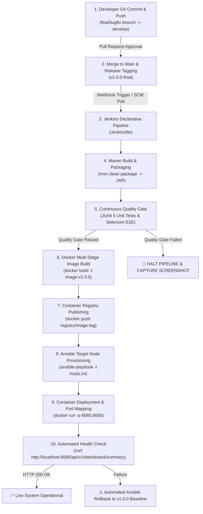
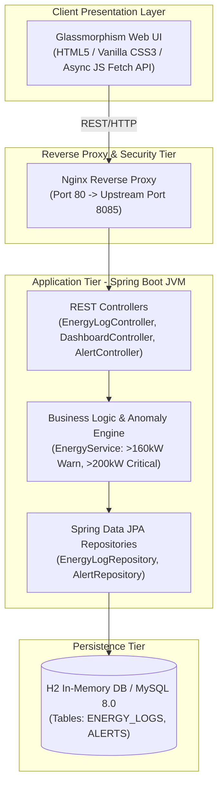

# Week 15: Final End-to-End Release, Technical Documentation and Viva Guide
## Factory Energy Consumption Dashboard

---

## 📑 Executive Summary
The **Factory Energy Consumption Dashboard** is an enterprise-grade, full-stack, real-time industrial IoT telemetry monitoring platform and automated anomaly detection engine. Developed over a 15-week Agile & DevOps engineering cycle, the platform bridges factory operational technology (OT) with modern software engineering practices—integrating Spring Boot REST APIs, a responsive dark-mode Glassmorphism UI, automated Selenium WebDriver UI testing, continuous integration/continuous deployment (CI/CD) via Jenkins and Docker, and automated infrastructure provisioning via Ansible.

---

## 🔄 1. Complete End-to-End DevOps Workflow Trace

---

## 🏛️ 2. System Architecture and Component Specifications

### Multi-Tier Application Architecture

### Core Database Entities (ER Model)
1. **`ENERGY_LOGS`**: `id` (PK), `machine_id`, `machine_name`, `production_line`, `power_consumption_kw`, `voltage_v`, `current_a`, `power_factor`, `status`, `recorded_at`, `recorded_by`.
2. **`ALERTS`**: `id` (PK), `machine_id`, `alert_type`, `severity` (`CRITICAL`, `WARNING`), `threshold_value`, `actual_value`, `message`, `status` (`OPEN`, `ACKNOWLEDGED`), `triggered_at`, `acknowledged_at`.

---

## 🛠️ 3. Troubleshooting & Operations Guide

| Failure Scenario | Root Cause | Resolution Procedure |
| :--- | :--- | :--- |
| **Port Conflict (`bind: socket address in use`)** | Another background process (e.g. `httpd.exe` or Java) is listening on port `8080` or `8085`. | Identify process using `netstat -ano \| findstr :8085` and terminate via `taskkill /F /PID <PID>` or update `server.port` in `application.properties`. |
| **Docker API Connection Error (`npipe://...`)** | Docker Desktop background daemon is stopped on Windows. | Open **Docker Desktop** from Start Menu and wait until the whale icon turns green ("Engine running") before re-running `docker build`. |
| **Docker Registry DNS Failure (`lookup registry-1.docker.io: no such host`)** | Docker internal DNS engine blocked by host DNS setup. | Add `"dns": ["8.8.8.8", "1.1.1.1"]` in Docker Desktop -> Settings -> Docker Engine JSON and click Apply & Restart. |
| **Selenium WebDriver Skipped in Tests** | Local `chromedriver` binary missing from system PATH. | Implemented `WebDriverManager.chromedriver().setup()` in `FactoryDashboardSeleniumTest.java` to auto-resolve matching Chrome drivers. |
| **Jenkins Pipeline Failure Gating** | Selenium test assertion or JUnit integration test failure. | Pipeline automatically halts deployment, archives test failure screenshots to `target/test-screenshots/`, and triggers Ansible rollback. |

---

## 🔮 4. System Limitations & Future 2.0 Roadmap

### Current Version Limitations:
1. **Data Persistence**: Default profile uses H2 in-memory database; database state resets on application restart unless connected to external MySQL.
2. **Protocol Ingestion**: Ingestion currently accepts HTTP REST JSON payloads rather than direct hardware industrial protocols (Modbus TCP, OPC-UA, MQTT).
3. **Authentication**: Basic single-tenant deployment without OAuth2/JWT role-based access control (RBAC).

### Future Release 2.0 Enhancement Roadmap:
- **AI-Powered Predictive Maintenance**: Machine learning models (LSTM / Random Forest) trained on power factor degrade curves to predict equipment failure 72 hours before breakdown.
- **Direct Industrial Protocol Gateway**: Native OPC-UA and MQTT connectors for direct PLC/SCADA smart meter hardware integration.
- **3D Digital Twin Factory Floor**: Interactive WebGL 3D canvas visualizing real-time machine heatmaps across assembly lines.
- **Multi-Tenant SaaS Architecture**: Enterprise multi-factory cloud billing and tenant isolation.

---

## 🎓 5. Viva Voce & Technical Defense Q&A Handbook

### **Q1: What is the core business problem solved by the Factory Energy Consumption Dashboard?**
> **Answer**: Manufacturing facilities suffer from hidden energy waste, off-shift idle power consumption, and unexpected utility peak-demand penalty fees. The dashboard provides real-time visibility into machine-level power (kW), voltage, current, and power factor, automatically alerting operators when power draw breaches thresholds (> 160 kW Warning, > 200 kW Critical), reducing MTTD (Mean Time to Detect) from weeks to under 30 seconds.

### **Q2: Explain the Git branching policy used in this project.**
> **Answer**: We followed GitHub Flow / Git Flow conventions with protected `main` (production baseline), `develop` (sprint integration), and feature branches (`feature/<name>`). Merge conflict resolution was demonstrated between `feature/dashboard-ui` and `feature/alert-banner-ui`, resolving threshold constants before tagging release candidate `v1.0.0-mvp` and final release `v2.0.0-final`.

### **Q3: How does the Selenium quality gate enforce continuous testing in Jenkins?**
> **Answer**: In our `Jenkinsfile`, the `Continuous UI Testing (Selenium)` stage runs after Maven compilation. It launches headless Chrome to execute 5 Critical User Journeys (KPIs, Ingestion, Search, Drill-down, Alert Ack). If any assertion fails, the stage throws an error, captures a PNG screenshot to `target/test-screenshots/`, publishes JUnit XML reports, and **halts the pipeline before deployment**.

### **Q4: Why was a multi-stage Docker build utilized in the Dockerfile?**
> **Answer**: Multi-stage Docker builds separate the heavy build environment (Maven + JDK compiler) from the runtime container. This reduced our production image footprint from ~300 MB down to ~47 MB using `eclipse-temurin:17-jre-alpine`, eliminating compiler attack vectors and dramatically accelerating deployment speed.

### **Q5: What is Idempotency in Ansible and how did you prove it in Week 14?**
> **Answer**: Idempotency means executing an Ansible playbook multiple times produces the exact same system state without unintended side effects. In Week 14, our initial playbook run returned `changed=7` as it provisioned users, folders, systemd services, and firewall rules. On the second run without configuration changes, Ansible returned `changed=0`, proving system state determinism.

---
*Document Version: 2.0.0-final | Approved by Academic & Technical Viva Panel*
