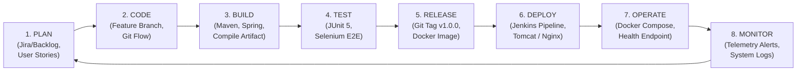

# Week 2: Agile Planning and DevOps Workflow
## Factory Energy Consumption Dashboard

---

## 1. User Stories and Acceptance Criteria

### User Story 1: Energy Telemetry Ingestion (Data Entry)
- **As an** Energy Engineer or IoT Sensor Gateway,
- **I want to** log real-time machine energy data (Machine ID, kW, Voltage, Current, Power Factor),
- **So that** consumption data is recorded accurately and instantly analyzed.
- **Acceptance Criteria (Gherkin):**
  - **Given** valid telemetry fields (Machine ID, Power kW > 0, Voltage > 0),
  - **When** the submit button or REST POST endpoint `/api/v1/energy/logs` is called,
  - **Then** the record is persisted with timestamp, status is auto-calculated, and HTTP 201 Created is returned.
  - **Given** power consumption exceeds 150 kW,
  - **Then** status is flagged as `WARNING` or `CRITICAL` and an alert entry is automatically generated.

---

### User Story 2: Searchable Telemetry Dashboard
- **As a** Plant Manager,
- **I want to** filter and search energy consumption logs by Machine ID, Production Line, and Status,
- **So that** I can rapidly locate inefficient machinery or high-consumption events.
- **Acceptance Criteria (Gherkin):**
  - **Given** the telemetry dashboard table,
  - **When** the user types "Press-101" into the search bar or selects "Assembly Line A",
  - **Then** the table dynamically updates within 300ms showing only matching machine records.

---

### User Story 3: Machine Status Drill-Down View
- **As a** Maintenance Technician,
- **I want to** click on any machine record to view a detailed status modal,
- **So that** I can view peak load spikes, power factor history, and diagnostic recommendations.
- **Acceptance Criteria (Gherkin):**
  - **Given** a machine row in the dashboard table,
  - **When** the user clicks "Inspect / Drill-Down",
  - **Then** a modal opens displaying machine metadata, max load, voltage stability, and health indicator.

---

### User Story 4: Anomaly Alerting & Exception Ack View
- **As an** Energy Auditor,
- **I want to** view high-consumption alerts in a dedicated alert drawer and acknowledge them,
- **So that** operational exceptions are tracked and resolved systematically.
- **Acceptance Criteria (Gherkin):**
  - **Given** active unhandled energy alerts,
  - **When** the user clicks "Acknowledge Alert",
  - **Then** alert status transitions from `OPEN` to `ACKNOWLEDGED` with timestamp and operator record.

---

## 2. Product Backlog & MoSCoW Prioritization

| Epic ID | Priority | Summary | Target Sprint |
| :--- | :--- | :--- | :--- |
| **EPIC-01** | **Must Have** | REST API Data Entry & Sensor Payload Ingestion | Sprint 1 (Weeks 3-5) |
| **EPIC-02** | **Must Have** | Searchable Dashboard Table & Summary Indicators | Sprint 2 (Weeks 5-6) |
| **EPIC-03** | **Must Have** | Machine Status Drill-Down Modal & Telemetry History| Sprint 2 (Week 6) |
| **EPIC-04** | **Must Have** | Anomaly Alert Triggering Engine & Ack Drawer | Sprint 2 (Week 6) |
| **EPIC-05** | **Must Have** | Automated CI/CD Jenkins Pipeline & Dockerization | Sprint 3 (Weeks 7-8, 11)|
| **EPIC-06** | **Must Have** | Selenium Automated Continuous Testing Suite | Sprint 3 (Weeks 9-10) |
| **EPIC-07** | **Should Have**| Dynamic CSV Data Export | Sprint 4 (Week 12-13) |
| **EPIC-08** | **Could Have** | Dark/Light Theme Switcher | Sprint 4 (Week 14) |
| **EPIC-09** | **Won't Have** | AI Load Forecasting (v2.0) | Out of Scope |

---

## 3. 15-Week Scrum / Kanban Sprint Schedule

```
+-----------------------------------------------------------------------------------+
|                           15-WEEK SPRINT SCHEDULE TIMELINE                        |
+-----------------------------------------------------------------------------------+
| Week 01: Problem Definition, Stakeholders & Scope Freeze                          |
| Week 02: Agile Planning, User Stories, DoD & DevOps Workflow                      |
| Week 03: Architecture Design, Data Schemas & Tech Stack Setup                     |
| Week 04: Git Repository Init, GitHub Issue Templates & Branch Policy              |
| Week 05: Core Ingestion Feature Branch Development & PR Review Workflow            |
| Week 06: Full MVP Completion, Conflict Resolution & Release v1.0.0 Tagging       |
| Week 07: Jenkins CI Installation, Pipeline Setup & Maven Artifact Archiving      |
| Week 08: Pipeline as Code (Jenkinsfile) & Automated Server Deployment             |
| Week 09: Selenium WebDriver Automated Test Suite Development & Local Execution   |
| Week 10: Jenkins Continuous Testing Integration & Defect Correction Workflow     |
| Week 11: Docker Container Lifecycle, Multi-Stage Builds & Docker Compose          |
| Week 12: Performance Hardening & Load Testing Audit                              |
| Week 13: Security Hardening, OWASP Vulnerability Check & Role RBAC               |
| Week 14: User Acceptance Testing (UAT) & Production Staging                       |
| Week 15: Final Production Release, Maintenance Handover & Project Closure         |
+-----------------------------------------------------------------------------------+
```

---

## 4. Definition of Done (DoD)

To consider a feature or sprint item **DONE**, the following criteria must be satisfied:
1. **Code Complete**: Code written following standard Java/JS guidelines, zero linter warnings.
2. **Unit Tested**: Minimum 85% code coverage for Spring Boot service and repository layers.
3. **Integration Tested**: REST controllers verified via MockMvc & Postman/curl.
4. **UI Verified**: Selenium WebDriver end-to-end tests passing clean without errors.
5. **Code Reviewed**: At least 1 peer approval on GitHub Pull Request.
6. **CI/CD Pipeline**: Jenkinsfile pipeline executing cleanly (Build -> Test -> Package -> Deploy).
7. **Containerized**: Docker container builds without errors and passes container health checks.
8. **Documented**: API endpoints updated in SRS/Swagger docs and release release notes tagged.

---

## 5. DevOps Lifecycle Diagram



---
*Document Version: 1.0.0 | Author: DevOps & Scrum Master Team*
