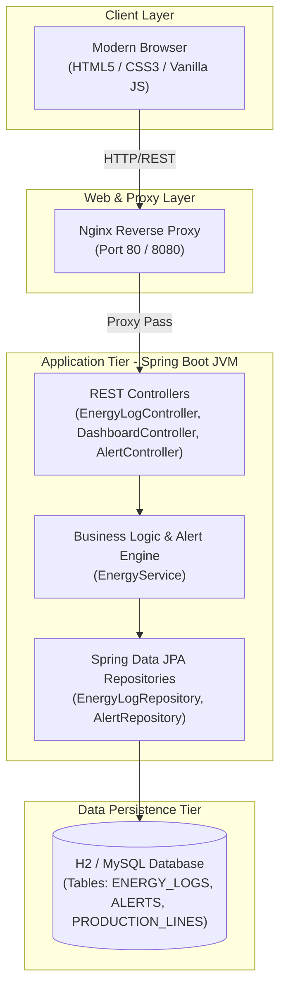

# Week 3: Requirements, Architecture and Technology Setup
## Factory Energy Consumption Dashboard

---

## 1. Software Requirements Specification (SRS) Summary

### Functional Requirements (FR)
- **FR-01 Data Ingestion**: The system shall accept energy telemetry records (machineId, machineName, productionLine, powerConsumptionKW, voltageV, currentA, powerFactor) via REST API and manual form UI.
- **FR-02 Real-Time Anomaly Engine**: The system shall evaluate incoming power consumption against preset thresholds (> 150 kW = WARNING, > 200 kW = CRITICAL) and generate alerts automatically.
- **FR-03 Summary Key Performance Indicators**: The dashboard shall compute and display real-time aggregates: Total Consumption (kWh), Peak Power (kW), Active Alerts Count, Average Power Factor, Efficiency Score (%).
- **FR-04 Search & Filter**: The UI shall enable instant text filtering across Machine ID, Production Line, and Status.
- **FR-05 Machine Status Drill-Down**: The system shall provide a modal/view displaying historical telemetry trends, peak load spikes, and equipment health status for any selected machine.
- **FR-06 Alert Management**: The system shall display active alerts with severity levels and allow users to acknowledge alerts.

### Non-Functional Requirements (NFR)
- **NFR-01 Performance**: REST API endpoints shall respond in < 200ms under standard loads.
- **NFR-02 Reliability**: Ingestion engine shall process data without loss; H2/MySQL persistence ensures durability.
- **NFR-03 Portability**: Application shall run standalone via embedded Tomcat/Spring Boot or in Docker containers.
- **NFR-04 Maintainability**: Clean multi-tier architecture separation (Controller, Service, Repository, DTO).

---

## 2. Use-Case Diagram

```mermaid
usecaseDiagram
    actor "Plant Manager" as PM
    actor "Energy Auditor" as EA
    actor "Maintenance Tech" as MT
    actor "IoT Sensor Gateway" as IoT

    package "Factory Energy Consumption Dashboard System" {
        usecase "UC-01: Ingest Telemetry Data" as UC1
        usecase "UC-02: View Dashboard & KPIs" as UC2
        usecase "UC-03: Search & Filter Telemetry" as UC3
        usecase "UC-04: Machine Status Drill-Down" as UC4
        usecase "UC-05: Monitor & Ack Alerts" as UC5
        usecase "UC-06: Export Telemetry Reports" as UC6
    }

    IoT --> UC1
    EA --> UC1
    PM --> UC2
    PM --> UC3
    MT --> UC4
    EA --> UC5
    PM --> UC6
```

---

## 3. Application Architecture Diagram



---

## 4. Data Model & REST API Specification

### Database Schema (ER Model)

```sql
CREATE TABLE energy_logs (
    id BIGINT AUTO_INCREMENT PRIMARY KEY,
    machine_id VARCHAR(50) NOT NULL,
    machine_name VARCHAR(100) NOT NULL,
    production_line VARCHAR(100) NOT NULL,
    power_consumption_kw DOUBLE NOT NULL,
    voltage_v DOUBLE NOT NULL,
    current_a DOUBLE NOT NULL,
    power_factor DOUBLE NOT NULL,
    status VARCHAR(20) NOT NULL,
    timestamp TIMESTAMP DEFAULT CURRENT_TIMESTAMP,
    recorded_by VARCHAR(50)
);

CREATE TABLE alerts (
    id BIGINT AUTO_INCREMENT PRIMARY KEY,
    machine_id VARCHAR(50) NOT NULL,
    alert_type VARCHAR(50) NOT NULL,
    severity VARCHAR(20) NOT NULL,
    threshold_value DOUBLE NOT NULL,
    actual_value DOUBLE NOT NULL,
    message VARCHAR(255) NOT NULL,
    status VARCHAR(20) NOT NULL,
    triggered_at TIMESTAMP DEFAULT CURRENT_TIMESTAMP,
    acknowledged_at TIMESTAMP NULL
);
```

### REST API Endpoints Specification

| Method | Endpoint | Description | Sample Request/Response Payload |
| :--- | :--- | :--- | :--- |
| `POST` | `/api/v1/energy/logs` | Record new telemetry | `{"machineId":"M-101","powerConsumptionKW":185.5...}` -> `201 Created` |
| `GET` | `/api/v1/energy/logs` | List logs with filter params | `?machineId=M-101&line=Assembly Line A` |
| `GET` | `/api/v1/dashboard/summary`| Fetch high-level summary KPIs | `{"totalConsumptionKWh":1420.5,"peakPowerKW":210.0,"activeAlerts":3}` |
| `GET` | `/api/v1/dashboard/drilldown/{machineId}` | Fetch machine drill-down details | `{"machineId":"M-101","avgPowerKW":165.2,"healthScore":88}` |
| `GET` | `/api/v1/alerts` | List all system alerts | `[{"id":1,"machineId":"M-101","severity":"CRITICAL"...}]` |
| `PUT` | `/api/v1/alerts/{id}/acknowledge` | Acknowledge active alert | Updates alert status to `ACKNOWLEDGED` |

---

## 5. Technology Stack & Local Development Setup

- **Java JDK**: OpenJDK 17/21
- **Build Tool**: Apache Maven (`mvnw` wrapper included)
- **Framework**: Spring Boot 3.x / 4.x (Web, JPA, Validation)
- **Database**: H2 In-Memory Database (Development) / MySQL 8.0 (Production ready)
- **Frontend**: Vanilla HTML5, CSS3 Glassmorphism UI, JavaScript ES6 Async Fetch API
- **Web Server Target**: Embedded Apache Tomcat / Nginx Reverse Proxy
- **Testing**: JUnit 5, Selenium WebDriver (Headless/Chrome)
- **CI/CD & DevOps**: Jenkins Pipeline, Docker, Docker Compose

---
*Document Version: 1.0.0 | Author: Software Architecture Team*
